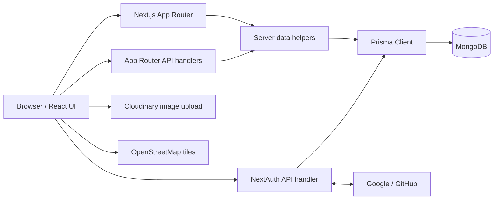
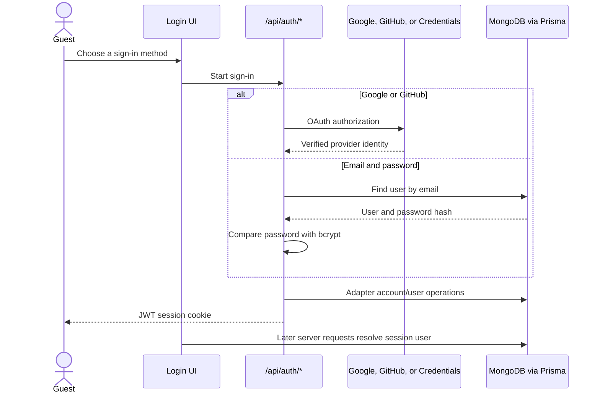
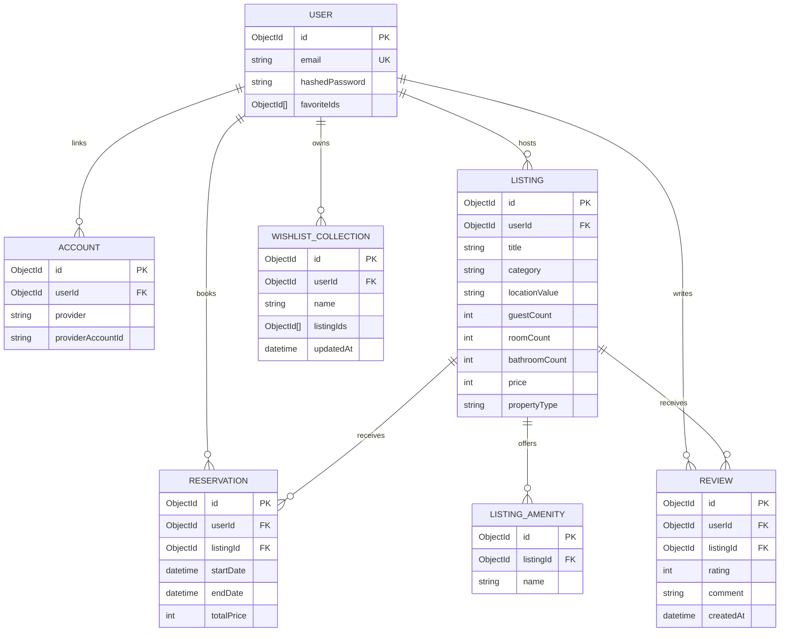
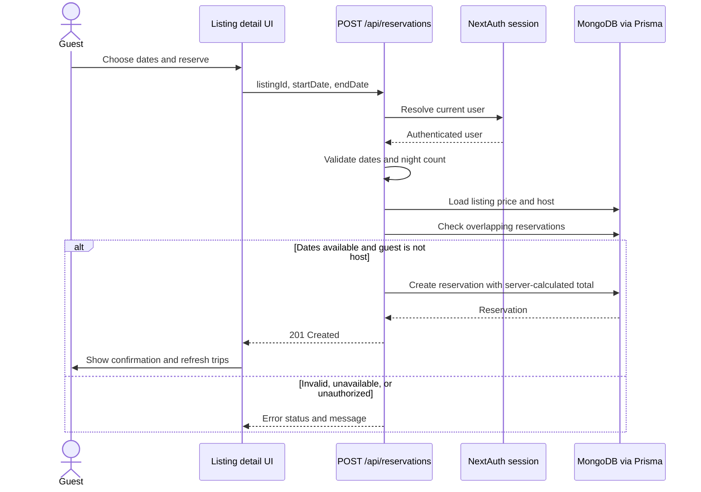

# Technical Overview

This document describes the current implementation of the Airbnb-style property app. It complements the setup instructions in the [README](../README.md).

## 1. System Architecture

The UI is served by Next.js App Router pages and React components. Server components and data helpers access MongoDB through a shared Prisma client. Browser interactions that mutate data call App Router route handlers. NextAuth remains a Pages Router API endpoint because the project uses NextAuth v4.



### Runtime and major packages

- Node.js `>=20.9.0`
- Next.js `16.4.6`, React `19.3.1`, TypeScript 5
- Tailwind CSS 3 for styling
- Prisma `5.22.0` with the MongoDB connector
- NextAuth `4.24.15` with a Prisma adapter and JWT sessions
- Leaflet / React Leaflet for maps
- `next-cloudinary` for the unsigned listing image upload widget
- `next-themes` for light, dark, and device themes
- ESLint 9 with the Next.js flat config

## 2. Request and Rendering Model

### App shell

`app/layout.tsx` loads the current user, then renders the theme and toast providers, global modals, navbar, route content, and footer. The navbar receives the user on the server. Theme selection is available in the profile menu.

### Data access

Functions in `app/actions/` are server-side data helpers. They query Prisma and convert dates to ISO strings before passing records to client components. They are not all framework Server Actions; many are server-only helper functions imported by route pages.

### API handling

Files under `app/api/` implement App Router route handlers. They validate request data, load the authenticated user when needed, check ownership or reservation state, then write through Prisma. The Pages Router is only retained for `/api/auth/[...nextauth]`.

### Authentication flow



Credentials passwords are stored as bcrypt hashes by the registration endpoint. `getCurrentUser()` reads the NextAuth server session and returns a reduced user record without the password hash.

## 3. Data Model

MongoDB ObjectIds are used for model IDs and references. Prisma relations use cascade deletion for owned data where configured.



Implementation details:

- `User.favoriteIds` stores listing IDs directly on a user.
- `WishlistCollection.listingIds` stores the ordered listing IDs for each collection; the collection has a user relation for ownership checks.
- `Review` has a unique `(userId, listingId)` constraint. Submitting another review for the same listing updates the existing review.
- `Listing.propertyType` is optional for existing data compatibility. The host form no longer asks for it, and the listing detail UI does not display it. New API-created listings default it to `Entire place`.
- Indexes support listing creation order, category/location recommendations, amenity lookup, review lookup, and user wishlist lookup.

## 4. Core User Flows

### Search and browse

1. Category navigation sets a `category` query parameter.
2. The search modal collects location, date range, guest count, room count, and bathroom count.
3. The home page awaits `searchParams` and calls `getListings()` with those values.
4. Prisma queries matching listings and excludes listings with overlapping reservations for the selected date range.
5. `ListingResults` renders listing cards or a map view. Map pins are grouped at country coordinates from the country dataset; selecting a marker opens listing links.

The current search UI does not expose price, property-type, or amenity filters. The data helper still contains optional query support for these fields for future use.

### Reservation



The reservation API recalculates `totalPrice` from the listing price and dates. It rejects invalid durations, self-booking, and overlapping reservations.

### Reviews

1. Listing detail loads up to 30 most recent reviews and whether the current user has an eligible completed stay.
2. A signed-in guest may submit a 1–5 rating and a 5–1000 character comment after the reservation end date.
3. Hosts cannot review their own listing.
4. The unique user/listing key means the review endpoint creates the first review and updates it on subsequent submissions.

### Wishlists and favorites

- Favorites use `User.favoriteIds`, updated by `POST` and `DELETE /api/favorites/[listingId]`.
- Wishlists are named collections. The user creates collections, adds/removes listings, renames or deletes collections, and can open a collection detail page.
- The wishlist API checks that the current user owns the collection before updating it.

## 5. Routes and API Surface

### Pages

| Path | Purpose |
| --- | --- |
| `/` | Searchable listing grid and list/map toggle |
| `/listings/[listingId]` | Listing detail, reservation, reviews, recommendations, save-to-collection |
| `/trips` | Guest reservations |
| `/reservations` | Reservations for hosted listings |
| `/properties` | Current user's listings |
| `/favorites` | Favorite listings |
| `/wishlists` | User's collections |
| `/wishlists/[wishlistId]` | A collection and its saved listings |

`proxy.ts` protects `/trips`, `/reservations`, `/properties`, and `/favorites`. API handlers still perform their own checks for mutations and private data.

### API endpoints

| Method and path | Purpose |
| --- | --- |
| `POST /api/register` | Validate and create a credentials account; rate limited per process |
| `POST /api/listings` | Create a listing and its amenities |
| `DELETE /api/listings/[listingId]` | Delete an owned listing |
| `POST`, `DELETE /api/favorites/[listingId]` | Add or remove a favorite |
| `POST /api/reservations` | Create a reservation |
| `DELETE /api/reservations/[reservationId]` | Cancel an authorized reservation |
| `POST /api/listings/[listingId]/reviews` | Create or update an eligible review |
| `POST /api/wishlists` | Create a collection |
| `PATCH`, `DELETE /api/wishlists/[wishlistId]` | Rename, edit contents, or delete a collection |
| `/api/auth/*` | NextAuth sign-in, callback, and session routes |

Listing retrieval, reservation lists, reviews, recommendations, and wishlists are also loaded through server-side helpers under `app/actions/`.

## 6. UI, Maps, and Media

- `next-themes` stores the selected `light`, `dark`, or `system` theme and applies it as a class on the document root. CSS variables theme select menus and toast surfaces.
- Listing cards use Next Image with responsive `sizes`, reduced image quality, eager loading for the first visible cards, and lazy loading for later cards. Next's optimizer is enabled in development and production.
- Listing hero images load eagerly. Cloudinary remote images are allowed in `next.config.mjs`.
- The host image form uses `CldUploadWidget` with the `Unsigned_preset` upload preset; configure that preset in the Cloudinary account used by the deployment.
- Leaflet renders country-level map pins and uses OpenStreetMap tiles. Map scrolling is disabled by default so a map does not capture normal page scrolling.
- The shared modal keeps its action footer visible while long form content scrolls.

## 7. Security and Operational Notes

- Do not commit `.env` or `.env.local`. OAuth secrets, `NEXTAUTH_SECRET`, and the MongoDB URL belong in the deployment environment or local ignored env files.
- Credentials are compared with bcrypt; API inputs are validated server-side.
- Reservation prices are computed from database listing values rather than trusted client totals.
- Reservation, review, wishlist, and listing mutation endpoints require a session and apply ownership or eligibility checks.
- Registration throttling is stored in process memory. For multi-instance production deployments, replace it with a shared limiter (for example, backed by Redis or the hosting platform).
- Apply schema changes with `npx prisma db push` against the intended database, then regenerate the client. Do not run a schema push against production without reviewing the target `DATABASE_URL`.

## 8. Local Development and Maintenance

```bash
npm install
npx prisma generate
npm run dev
```

For a development database that has not received the current schema, run `npx prisma db push` first. To check lint and produce a production build:

```bash
npm run lint
npm run build
npm run start
```
